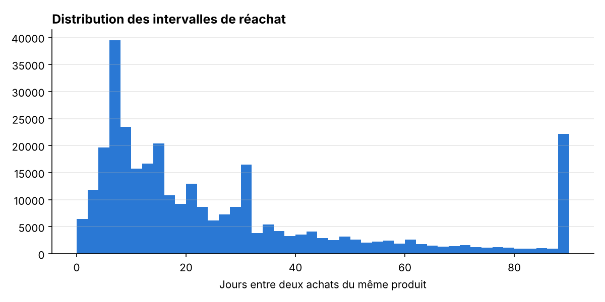
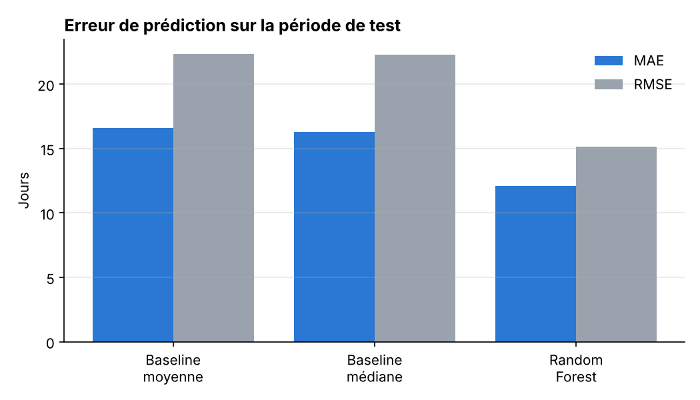
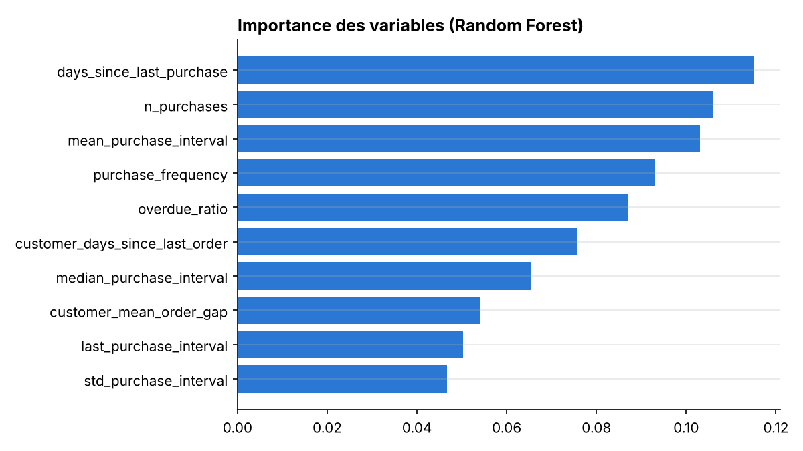
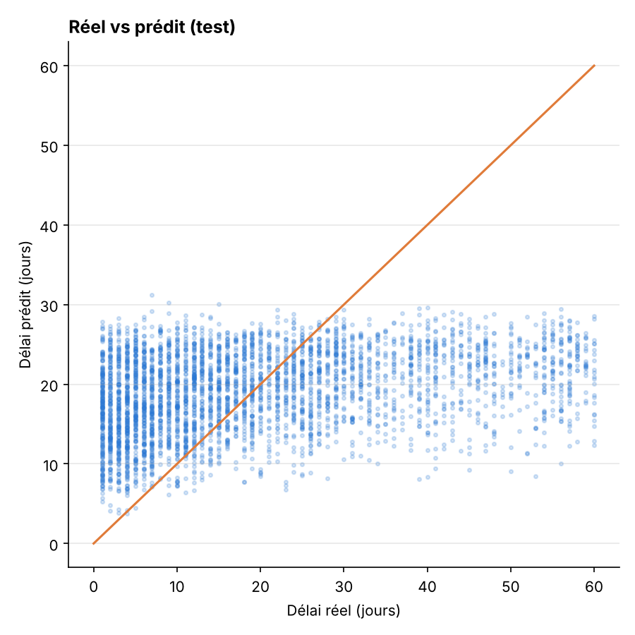
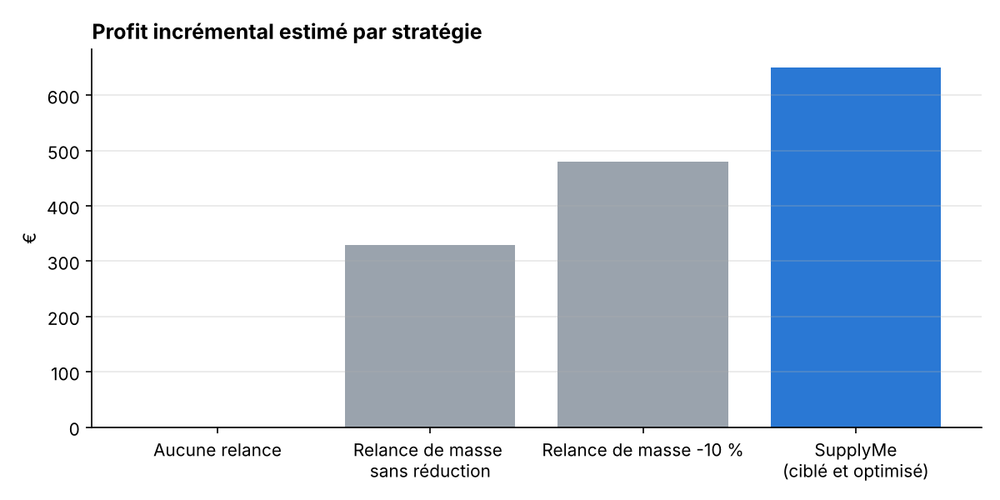

# SupplyMe — synthèse des résultats

*Source des données : **instacart** · date d'analyse : **2026-10-31***

## 1. Données

| Indicateur | Valeur |
|---|---|
| source | instacart |
| customers | 3000 |
| products | 25404 |
| orders | 54832 |
| order_items | 535691 |
| date_min | 2025-10-25 |
| date_max | 2026-10-31 |
| share_gaps_capped_at_30_days | 0.0947 |
| avg_basket_size | 9.77 |
| quantity_simulated | True |
| prices_simulated | True |
| household_size_simulated | True |
| orders_without_items | 0 |

## 2. Prédiction du prochain achat

Découpage temporel : 12 dates d'entraînement, 3 dates de test ; 127 808 observations d'entraînement, 98 052 de test. Part d'observations censurées (pas de réachat sous 60 j) : 36.0%.

|                 |    MAE |   RMSE |   MedAE |   within_3_days |   within_7_days |
|:----------------|-------:|-------:|--------:|----------------:|----------------:|
| baseline_mean   | 16.565 | 22.345 |  11.833 |           0.187 |           0.358 |
| baseline_median | 16.263 | 22.258 |  11     |           0.218 |           0.385 |
| random_forest   | 12.101 | 15.16  |  10.206 |           0.142 |           0.342 |

Gain de MAE du Random Forest vs baseline médiane : **25.6%**.

Classifieur « achat sous 7 jours » : AUC = **0.774**, Brier = 0.112 (taux de base 15.7%).

## 3. Moteur de décision marketing

Hypothèses : effet d'une relance = +8% de conversion des non-acheteurs ; élasticité à la réduction = 2.0 ; coût d'un contact = 0.05 € ; réductions testées : 5%, 10%, 15%, 20%.

| segment         | decision    |    n |   avg_discount |   profit |
|:----------------|:------------|-----:|---------------:|---------:|
| besoin_depasse  | A_relance   |  300 |          0     |    16.84 |
| besoin_depasse  | B_promotion | 3497 |          0.103 |   625.14 |
| besoin_depasse  | C_aucune    |  102 |          0     |     0    |
| besoin_imminent | A_relance   |  316 |          0     |     8.46 |
| besoin_imminent | C_aucune    |   90 |          0     |     0    |

### Comparaison des stratégies

| strategie                       |   clients_contactes |   achats_incrementaux |   cout_contacts |   cout_reductions |   profit_incremental |     roi |
|:--------------------------------|--------------------:|----------------------:|----------------:|------------------:|---------------------:|--------:|
| Aucune relance                  |                   0 |                   0   |            0    |              0    |                 0    | nan     |
| Relance de masse sans réduction |                1485 |                 270.9 |           74.25 |              0    |               329.2  |   4.434 |
| Relance de masse -10 %          |                1485 |                 948.1 |           74.25 |            858.51 |               479.3  |   0.514 |
| SupplyMe (ciblé et optimisé)    |                1428 |                 893.3 |           71.4  |            662.29 |               650.45 |   0.887 |

## 4. Figures

## 5. Limites

- Instacart ne contient ni dates absolues, ni prix, ni quantités, ni taille des foyers : ces éléments sont reconstruits ou simulés.
- `days_since_prior_order` est plafonné à 30 jours dans Instacart : les longs intervalles sont sous-estimés.
- Le réachat est utilisé comme approximation du besoin (pas de données de stock).
- Les effets des relances et des réductions sont des hypothèses : une campagne test (A/B test) serait nécessaire pour les estimer.