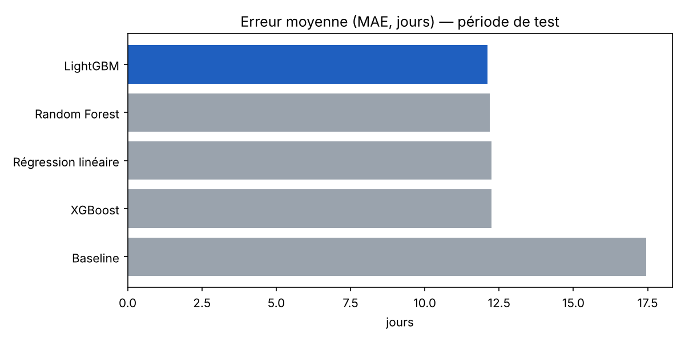
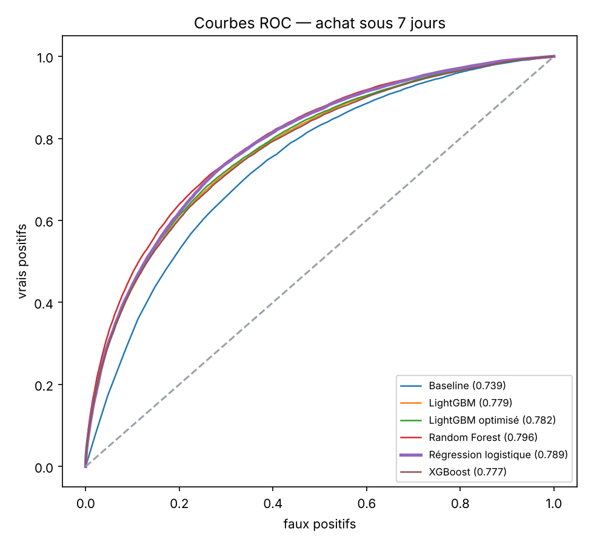
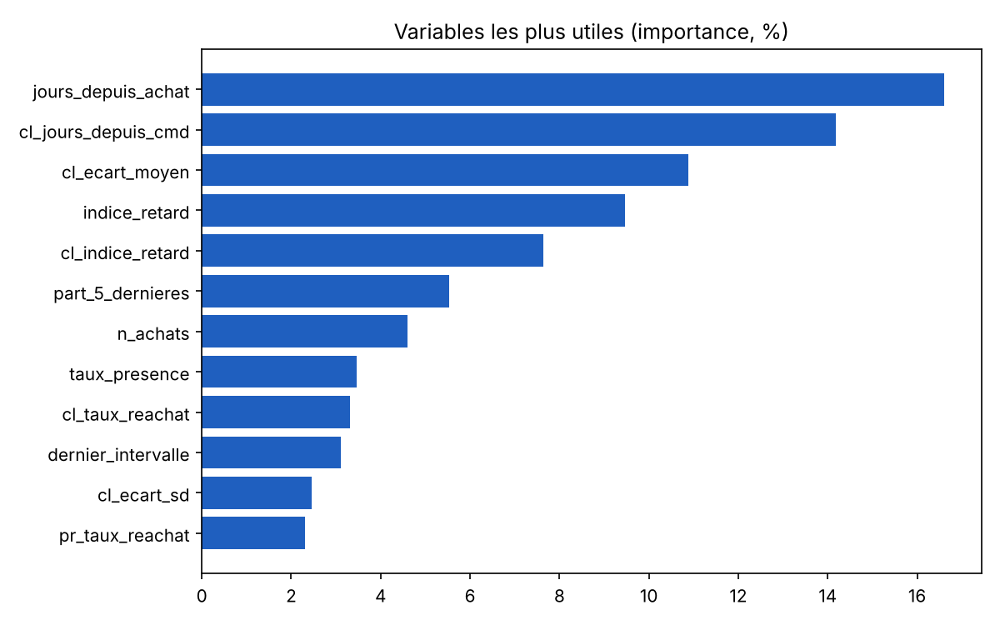
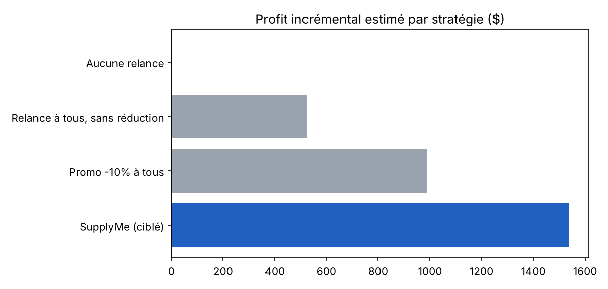
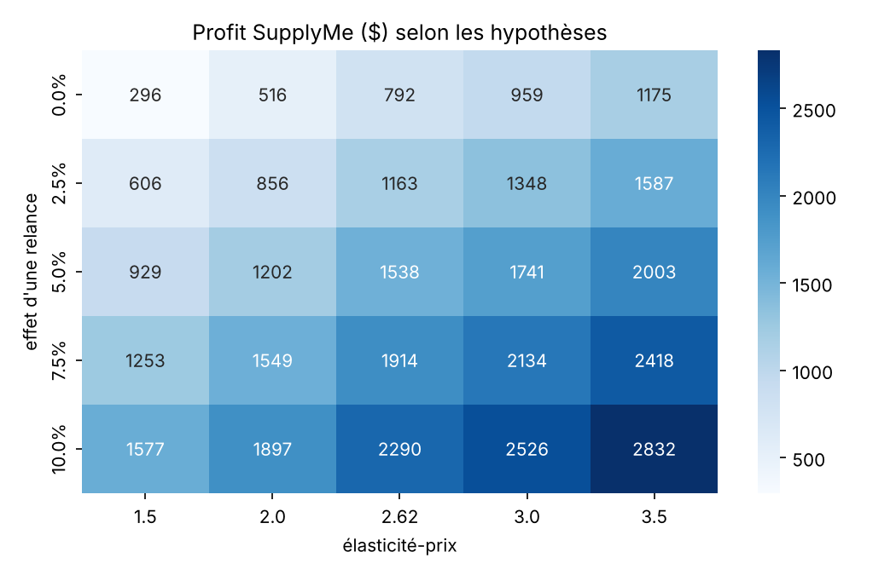

# SupplyMe — synthèse des résultats

Données Instacart : 3,000 clients, 48,306 commandes, période 2025-10-19 → 2026-10-31.

## Prédiction du délai avant le prochain achat (test)

| model               |   % à ±7 j |   MAE (j) |   RMSE (j) |     R² |   gain MAE vs baseline (%) |
|:--------------------|-----------:|----------:|-----------:|-------:|---------------------------:|
| LightGBM            |     38.747 |    12.11  |     15.702 |  0.03  |                     30.606 |
| Random Forest       |     33.548 |    12.186 |     15.05  |  0.109 |                     30.173 |
| Régression linéaire |     33.168 |    12.248 |     15.14  |  0.098 |                     29.818 |
| XGBoost             |     36.177 |    12.25  |     15.537 |  0.05  |                     29.804 |
| Baseline            |     35.674 |    17.452 |     23.426 | -1.16  |                      0     |

## Probabilité de rachat sous 7 jours (test)

| model                 |   AUC |   Average Precision |   Brier |
|:----------------------|------:|--------------------:|--------:|
| Random Forest         | 0.796 |               0.398 |   0.087 |
| Régression logistique | 0.789 |               0.372 |   0.088 |
| LightGBM optimisé     | 0.782 |               0.373 |   0.089 |
| LightGBM              | 0.779 |               0.371 |   0.089 |
| XGBoost               | 0.777 |               0.368 |   0.089 |
| Baseline              | 0.739 |               0.254 | nan     |

Taux de base : 11.7%.

## Décisions marketing

| segment         | decision    |   produits |   profit |
|:----------------|:------------|-----------:|---------:|
| besoin dépassé  | A — relance |          4 |     0.11 |
| besoin dépassé  | B — promo   |       3291 |  1524.08 |
| besoin dépassé  | C — rien    |         66 |     0    |
| besoin imminent | A — relance |        969 |    13.74 |
| besoin imminent | C — rien    |        332 |     0    |

## Rentabilité des stratégies ($)

| strategy                       |   customers_contacted |   incremental_profit |   discount_cost |   message_cost |
|:-------------------------------|----------------------:|---------------------:|----------------:|---------------:|
| Aucune relance                 |                     0 |                 0    |            0    |           0    |
| Relance à tous, sans réduction |                  1337 |               522.68 |            0    |          66.85 |
| Promo -10% à tous              |                  1337 |               989.93 |          521.06 |          66.85 |
| SupplyMe (ciblé)               |                  1274 |              1537.92 |          668.43 |          63.7  |

## Figures

